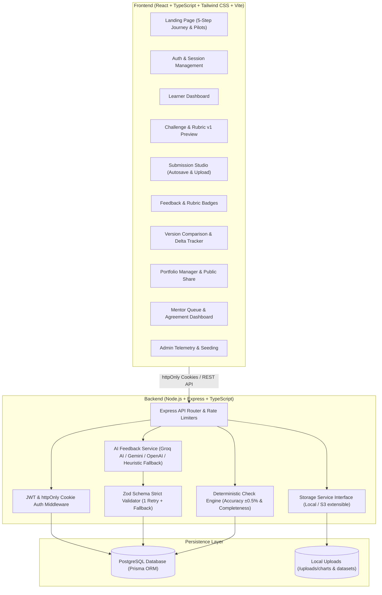

# SkillBridge

SkillBridge is an MVP platform designed for college students, self-taught developers, and career builders to practise real-world workplace tasks, receive rubric-calibrated evaluation on what to improve, and build a verified, honest portfolio.

---

## 1. System Architecture



---

## 2. Assessment Engine & Logic

Assessment scores each criterion on a 4-level scale:
- **Meets**
- **Mostly meets**
- **Partly meets**
- **Not yet**

| Criterion | What is Checked | How It Is Evaluated | Tolerance / Rules |
|---|---|---|---|
| **Accuracy** | Calculations match dataset | **DETERMINISTIC** | Compares learner's numbers against stored ground truth with **±0.5% tolerance** (`Math.abs(actual - expected) / expected <= 0.005`). Wrong numbers are always flagged regardless of AI output. |
| **Completeness** | All required sections submitted | **DETERMINISTIC** | Structural checklist rules: structured metrics present, chart image uploaded, 3 distinct findings with figures, and methodology explanation provided. |
| **Reasoning** | Conclusions follow from cited numbers | **AI-ASSISTED** | Evaluates whether findings logically deduce workplace takeaways from cited quantitative figures and percentages. |
| **Communication** | Explanations and visuals are clear | **AI-ASSISTED** | Evaluates methodology transparency, terminology clarity, and chart visual accessibility. |

### Assessment Pipeline
1. **Deterministic Execution:** The backend runs numerical checks and completeness verification directly against database `AnswerKey` values derived from `sales.csv`.
2. **AI Prompt Framing:** The backend constructs an evaluation prompt containing *only* the task, rubric definitions, learner's text answers, deterministic results, and chart description. The AI is **never** asked to recompute numbers.
3. **Strict Schema & Retry:** The AI response is parsed against a strict Zod schema:
   `{ criteria: [{ name, level, strengths, missing, next_steps }], overall_next_step }`.
   If validation fails, the system retries once with error context. If a second failure occurs, it safely falls back to a `"feedback pending review"` status.
4. **Deterministic Level Enforcement:** Even if the AI attempts to assign a different level for Accuracy or Completeness, the engine enforces the deterministic result as ground truth.
5. **Mentor Sampling:** Mentors can independently review sampled assessments, assign their own criterion levels, and observe the live agreement rate with the automated system.

---

## 3. Technology Stack & Design System

- **Frontend:** React 18, TypeScript, Tailwind CSS, Motion (`motion/react` spring physics), Phosphor Icons, Vite.
- **Backend:** Node.js, Express, TypeScript, Prisma ORM, bcryptjs, jsonwebtoken, cookie-parser, multer, zod, express-rate-limit.
- **Database:** PostgreSQL (with Prisma Client).
- **Storage:** Local disk in development with an extensible `StorageService` interface for future S3/GCS compatibility.
- **Design Tokens (Taste Skill Calibrated):**
  - **Navy** (`#253653`): primary text, deep surfaces, dark accent headers.
  - **Action Blue** (`#38A0D8`): primary CTAs, active focus states.
  - **Highlight Orange** (`#E57116`): callouts, feedback highlights, badges.
  - **Accent Yellow** (`#F7C000`): secondary accents, score medals.
  - **Light Grey** (`#F5F5F5`): elevated card backgrounds.
- **Typography:** **Play** for modern geometric headings + **Inter** for readable body copy.

---

## 4. Setup & Running Instructions

### Option A: Running with Docker Compose (Recommended for Production / Containers)

Ensure Docker is installed and running, then execute:

```bash
docker compose up --build
```

- **Web App (Frontend):** http://localhost:3000
- **API (Backend):** http://localhost:5000
- **Postgres:** Port 5432

---

### Option B: Running Locally (Development Mode)

#### 1. Prerequisites
- Node.js v20+ or v24+
- PostgreSQL server (or local instance)

#### 2. Environment Configuration
Copy `.env.example` to `backend/.env`:
```bash
cp .env.example backend/.env
```

Ensure `DATABASE_URL` points to your PostgreSQL database.

#### 3. Install Dependencies & Seed
From the project root:
```bash
# In backend
cd backend
npm install
npx prisma generate
npx prisma db push
npm run seed

# In frontend
cd ../frontend
npm install
```

#### 4. Start Development Servers
In two separate terminals:
```bash
# Terminal 1: Backend API (port 5000)
cd backend
npm run dev

# Terminal 2: Frontend Vite (port 3000)
cd frontend
npm run dev
```

Visit **http://localhost:3000** in your browser.

---

## 5. Seeded Accounts & Quick Demo Logins

The application includes one-click demo login buttons on the login screen (`/auth`):

| Role | Email | Password | Access Capabilities |
|---|---|---|---|
| **Learner** | `learner@skillbridge.dev` | `Learner123!` | Dashboard, Challenge submission, Feedback view, Version history, Portfolio management |
| **Mentor** | `mentor@skillbridge.dev` | `Mentor123!` | All learner views + Mentor sampled assessment queue & Agreement calibration dashboard |
| **Admin** | `admin@skillbridge.dev` | `Admin123!` | All mentor views + System telemetry & database re-seed controls |

---

## 6. Running Unit Tests

To run the unit tests for the deterministic assessment logic and Zod validation:

```bash
cd backend
npm run test
```

Test coverage includes:
- Exact number matches (0.0% diff -> `Meets`).
- Boundary tolerance testing (0.3% diff -> `Meets`; 1.2% diff -> `Partly meets` / `Not yet`).
- Incorrect category detection.
- Incomplete checklist testing (missing chart, missing quantitative figures, short methodology).
- Combined deterministic pipeline integration.
- Strict Zod schema compliance & retry resilience.

---

## 7. Feature Status: Implemented vs. Stubbed

| Feature | Status | Details |
|---|---|---|
| **Landing Page** | Fully Implemented | 5-step journey, example challenge showcase, college pilot request modal, ethical disclosures with `[Partner logo]` placeholders. |
| **Auth & Security** | Fully Implemented | Email/password auth, bcrypt hashing (10 rounds), httpOnly session cookies, role guards (learner, mentor, admin), login rate limiting. |
| **Challenge & Dataset** | Fully Implemented | Seeded 200-row `sales.csv` download, ground truth answer key calculation, 4-level rubric v1 preview. |
| **Submission Studio** | Fully Implemented | Structured calculations, chart image drag-and-drop with live preview, 3 findings with figures, methodology textarea, optional spreadsheet attachment, autosave draft. |
| **Deterministic Engine** | Fully Implemented | Tolerance checking (±0.5%), completeness rules, unit tests. |
| **AI Assessment Pipeline**| Fully Implemented | Groq AI (`openai/gpt-oss-120b`) / Gemini / OpenAI adapter with strict Zod validation, 1 retry, and offline calibrated heuristic fallback. |
| **Feedback Screen** | Fully Implemented | Badges for each criterion, strengths, missing items, next steps, "AI-assisted feedback" label, add to portfolio action. |
| **Version History** | Fully Implemented | Side-by-side attempt comparison (Attempt 1 vs Attempt 2) with criterion level deltas and answer diffs. |
| **Portfolio & Public Sharing**| Fully Implemented | Private by default, toggle inclusion, unguessable 48-char tokens, instant revocation, public view (`/portfolio/view/:token`). |
| **Mentor Review Queue** | Fully Implemented | Sampled assessment queue, mentor scoring form, live Mentor-AI agreement rate metric. |
| **Admin Seeding & Controls**| Fully Implemented | Database re-seed button, live system metrics. |
| **Data Privacy** | Fully Implemented | GDPR-compliant "Delete my account and data" feature that permanently purges all user data. |
| **S3 Storage** | Stubbed for Extensibility | Uploads currently saved to local disk via `LocalStorageService` behind a polymorphic `StorageService` interface. AWS S3 SDK can be added by implementing the same interface. |

---

## 8. Known Limitations & Design Notes

1. **Local Disk Storage:** By default, files are saved locally to `./uploads`. For high-availability multi-instance deployments, implement `S3StorageService` under `backend/src/storage/storage.service.ts`.
2. **Chart Vision Analysis:** In the MVP, chart images are verified deterministically for valid MIME type and size, while the learner describes the chart in their findings. Future iterations can integrate multimodal vision endpoints (e.g. Gemini Vision API) to inspect axes labels directly from the pixels.
3. **Single Challenge Scope:** The MVP intentionally focuses on one end-to-end challenge ("Spreadsheet Insights") with deep rubric calibration rather than a shallow catalog.
